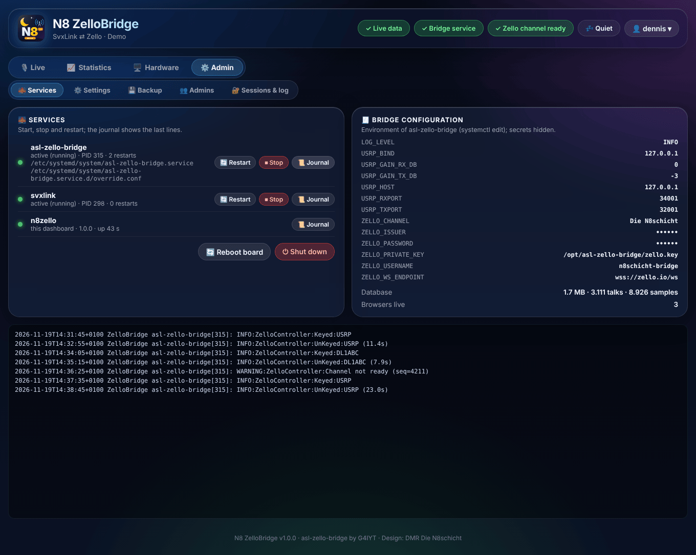
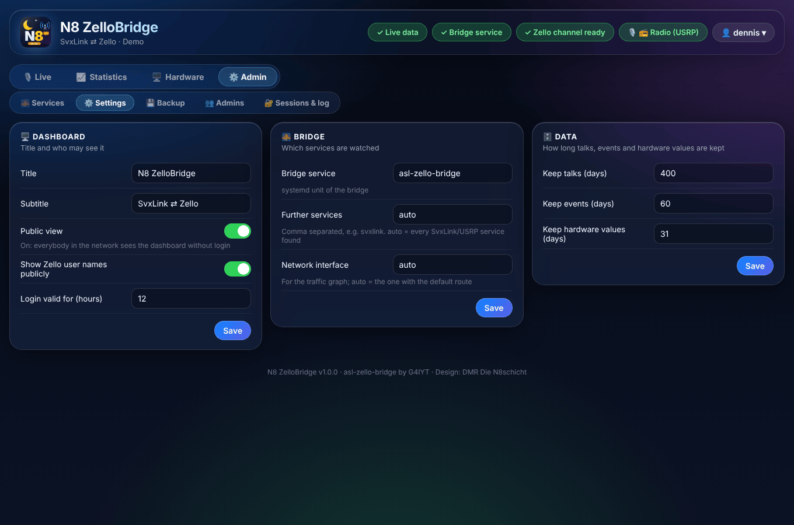

# ⚙️ Adminbereich

[← Übersicht](../../readme.md) · [Installation](installation.md) · [Dashboard](dashboard.md) · **Adminbereich** · [Die Bridge](bridge.md) · [Betrieb & Sicherung](betrieb.md)

Oben rechts **🔐 Login**, dann Tab **⚙️ Admin**.

## Rollen

| Rolle | Darf |
|---|---|
| **Superadmin** | alles; legt Admins an und löscht sie; startet das Board neu oder fährt es herunter. Wird bei der Installation festgelegt |
| **Admin** | Dienste steuern, Journal, Einstellungen, Sicherung |

Passwörter: mind. 10 Zeichen, scrypt-Hash. Nach 5 Fehlversuchen ist der Login für Name und IP 15 Minuten gesperrt.

## 🌉 Services

- **asl-zello-bridge** und weitere gefundene Dienste (z. B. `svxlink`): Neustart, Stopp/Start, **Journal** (letzte 300 Zeilen), dazu die Unit-Datei und Drop-ins.
- **Bridge configuration**: alle Umgebungsvariablen der Bridge – Passwörter, Schlüssel-IDs und Tokens als `••••••`. Geändert wird die Bridge weiterhin mit `sudo systemctl edit asl-zello-bridge` (siehe [Die Bridge](bridge.md)).
- **Reboot / Shut down** (nur Superadmin).

Der Dienstbenutzer darf per sudoers-Regel genau diese Dienste steuern und nichts anderes.

## ⚙️ Settings

| Einstellung | Vorgabe | Bedeutung |
|---|---|---|
| Title / Subtitle | N8 ZelloBridge | Kopfzeile |
| Public view | an | ohne Login sichtbar |
| Show Zello user names publicly | an | aus = ohne Login nur „Zello“ |
| Login valid for | 12 h | |
| Bridge service | asl-zello-bridge | systemd-Dienst der Bridge |
| Further services | auto | `auto` = alle SvxLink-/USRP-Dienste, sonst Liste |
| Network interface | auto | für den Netzwerk-Verlauf |
| Keep talks / events / hardware values | 400 / 60 / 31 Tage | |

Alles liegt in SQLite (`/var/lib/n8zello/n8zello.db`), es gibt keine Konfigurationsdatei. Nur Web-Port und Datenverzeichnis stehen im systemd-Dienst.

## 💾 Backup

Ein Klick lädt `zellobridge-backup-DATUM.tar.gz` herunter: Unit und Drop-ins der Bridge (Zello-Zugangsdaten, Kanal, Ports), den Zello-Schlüssel, die SvxLink-Konfiguration und eine Kopie der Dashboard-Datenbank. **Enthält Passwörter – sicher aufbewahren.** Wiederherstellen: [Betrieb & Sicherung](betrieb.md).

## 👥 Admins · 🔐 Sessions & log

Admins anlegen und löschen (Superadmin), aktive Sitzungen und das Protokoll aller Logins, Neustarts, Änderungen und Sicherungen.
