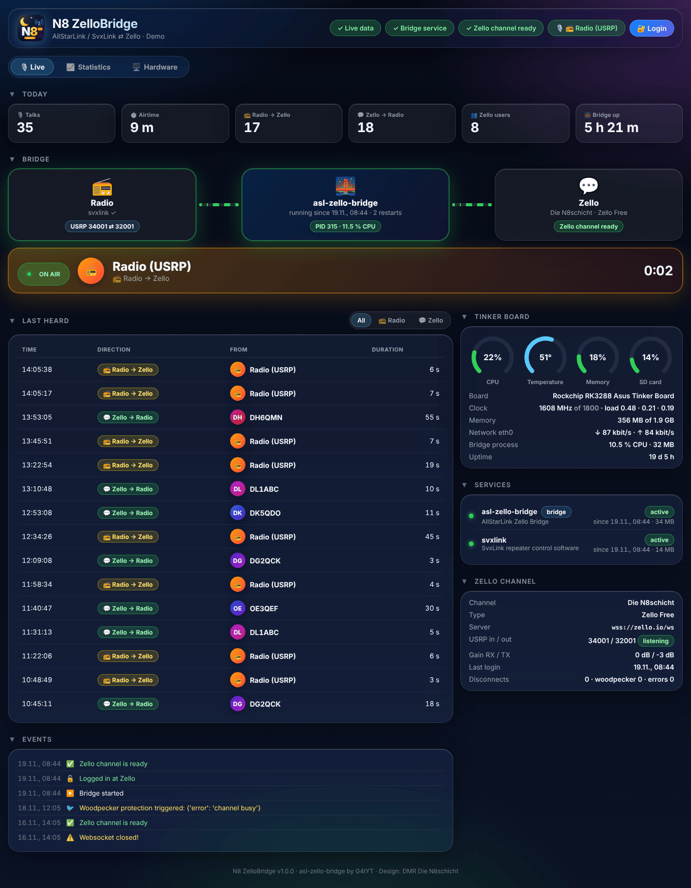
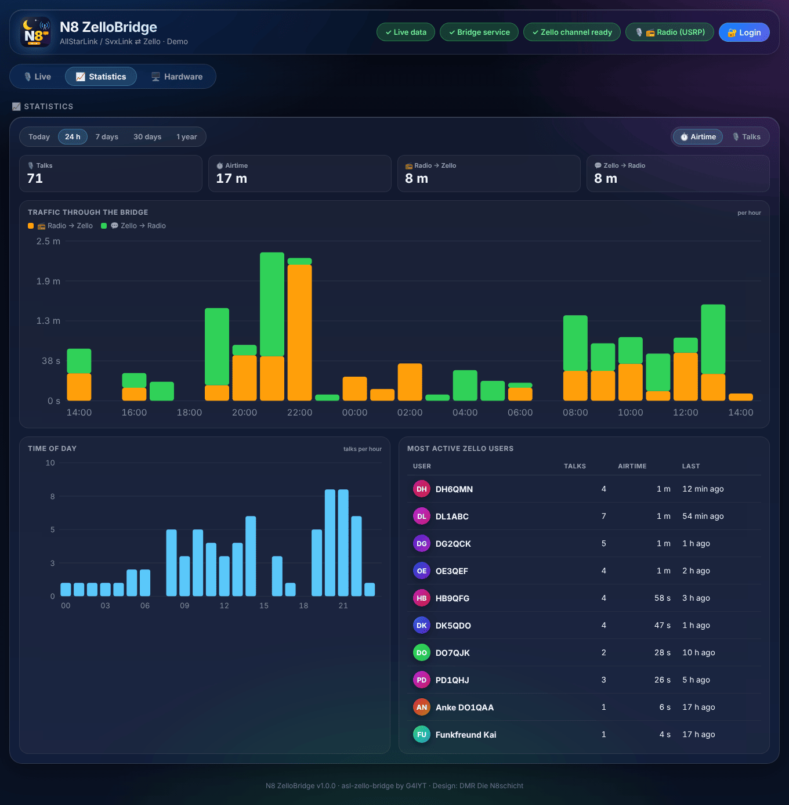
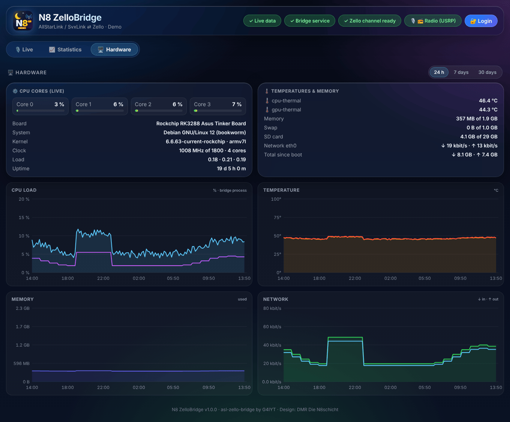
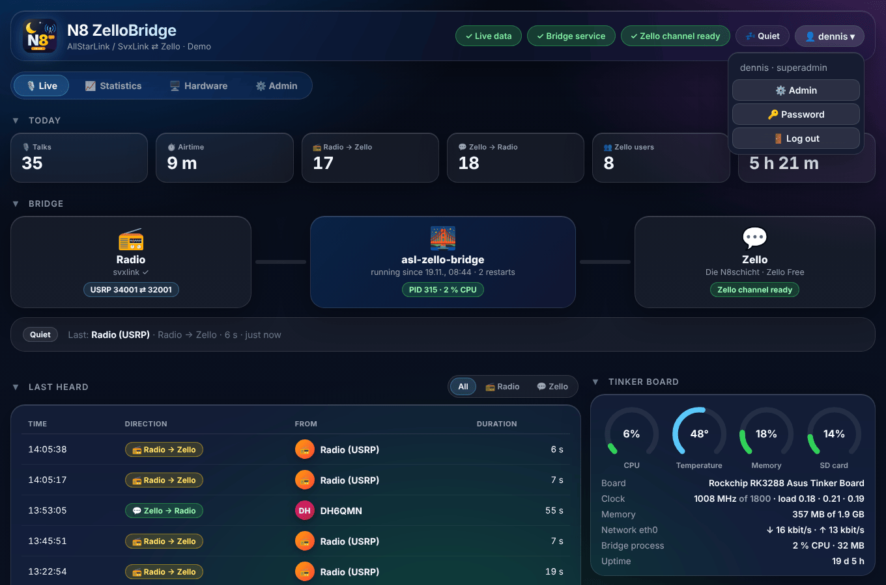

# 🎙️ Dashboard

[← Übersicht](../../readme.md) · [Installation](installation.md) · **Dashboard** · [Adminbereich](adminbereich.md) · [Die Bridge](bridge.md) · [Betrieb & Sicherung](betrieb.md)

Eine Seite mit drei Tabs. Live-Werte kommen per Server-Sent Events ohne Neuladen: Hardware alle 5 Sekunden, Bridge-Ereignisse sofort.

## Woher die Werte kommen

| Wert | Quelle |
|---|---|
| Wer spricht, Dauer, Richtung | Journal der Bridge: `Keyed:USRP` / `UnKeyed:USRP (12.3s)` = Funk → Zello, `Keyed:<Zello-Name>` = Zello → Funk |
| Zello-Status | Journal: `Connecting to …`, `Logged in!`, `Channel is ready`, `Websocket closed!`, Fehler |
| Dienststatus, PID, Neustarts | `systemctl show` |
| Kanal, USRP-Ports, Gain | Umgebung des Bridge-Dienstes (`Environment=` aus `systemctl edit`) |
| USRP „listening“ | `/proc/net/udp`: ist der RX-Port gebunden? |
| Hardware | `/proc` und `/sys` (CPU, Takt, Thermal-Zonen, Speicher, SD-Karte, Netzwerk) |

Das Journal wird mit `journalctl -f` verfolgt; die Position steht in SQLite, sodass nach einem Neustart des Dashboards nichts verloren geht.

## Tab 🎙️ Live

- **Kopfzeile**: Live-Verbindung, Bridge-Dienst, Zello-Status, wer gerade spricht.
- **Today**: Durchgänge, Sprechzeit, Funk → Zello, Zello → Funk, verschiedene Zello-Nutzer, Laufzeit der Bridge.
- **Bridge**: 📻 Funk (mit SvxLink-Status und USRP-Ports) ⇄ 🌉 asl-zello-bridge (Dienst, PID, CPU) ⇄ 💬 Zello (Kanal, Typ, Status). Die Verbindungslinie läuft in Sprechrichtung; rot = unterbrochen. Darunter **ON AIR** – orange für Funk → Zello, grün für Zello → Funk – oder der letzte Durchgang.
- **Last heard**: die letzten Durchgänge, filterbar nach Richtung.
- **Events**: Login, Kanal bereit, Verbindungsabbrüche, Woodpecker-Schutz, Fehler, Dienst-Neustarts.
- **Tinker Board**: Zeiger für CPU, Temperatur, Speicher, SD-Karte; Takt, Last, Netzwerk, Bridge-Prozess, Uptime.
- **Services** und **Zello channel**: Dienste mit Status und Speicher; Kanal, Typ (Zello Free / Work), Server, USRP-Ports, Gain, letzter Login, Abbrüche.

Alle Abschnitte lassen sich mit **▾** zuklappen; der Browser merkt sich das.

## Tab 📈 Statistics

Zeitraum *Today, 24 h, 7/30 days, 1 year*, Maß *Airtime* oder *Talks*: Verkehr durch die Bridge nach Richtung (gestapelt), Tageszeit, aktivste Zello-Nutzer. Durchgänge unter einer halben Sekunde (Tastendrücker) werden nicht gezählt.

## Tab 🖥️ Hardware

CPU-Kerne live, Board, System, Kernel, Takt, alle Temperaturfühler, Speicher, Swap, SD-Karte, Netzwerk. Darunter Verläufe über 24 h, 7 oder 30 Tage: CPU (mit Anteil der Bridge), Temperatur (Mittel und Maximum), Speicher, Netzwerk. Gespeichert wird ein Wert pro Minute.

## Login

Ist *Public view* aus, sehen nur angemeldete Admins das Dashboard. Ist *Show Zello user names publicly* aus, steht ohne Login nur „Zello“ statt des Namens.
