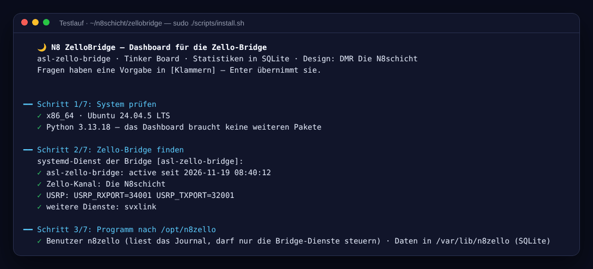
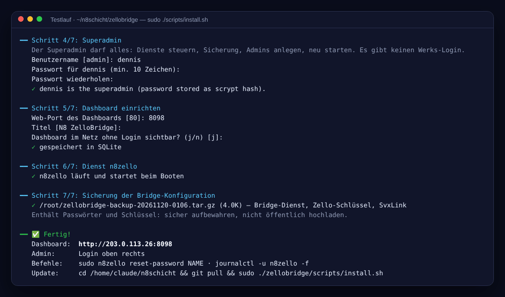

# 📦 Installation

[← Übersicht](../../readme.md) · **Installation** · [Dashboard](dashboard.md) · [Adminbereich](adminbereich.md) · [Die Bridge](bridge.md) · [Betrieb & Sicherung](betrieb.md)

## Voraussetzungen

| | |
|---|---|
| Gerät | Asus Tinker Board (oder jedes andere Linux mit systemd) mit DietPi / Debian |
| Bridge | [asl-zello-bridge](https://github.com/mattmelling/asl-zello-bridge) als systemd-Dienst (bei der N8schicht: `asl-zello-bridge.service`) |
| Python | 3.9 oder neuer – ist durch die Bridge schon vorhanden |
| Pakete | **keine** – nur die Python-Standardbibliothek und SQLite |
| Speicher | unter 30 MB RAM, wenige MB auf der SD-Karte |

## Schritt für Schritt

```bash
git clone https://github.com/dhartmann1979/n8schicht
cd n8schicht/zellobridge
sudo ./scripts/install.sh
```

Jede Frage hat eine Vorgabe in `[Klammern]`, Enter übernimmt sie. Die Bridge selbst wird **nicht** verändert.

<p align="center"></p>

| Schritt | Was passiert |
|---|---|
| **1 System prüfen** | Board-Modell, Betriebssystem, DietPi, Python mit SQLite |
| **2 Zello-Bridge finden** | sucht den Dienst der Bridge, zeigt Status, Zello-Kanal und USRP-Ports; findet weitere Dienste wie `svxlink` |
| **3 Programm** | kopiert das Dashboard nach `/opt/n8zello`, legt den Dienstbenutzer `n8zello` an (darf das Journal lesen und **nur** die gefundenen Bridge-Dienste steuern), dazu `/usr/local/bin/n8zello` und das Sicherungs-Skript |
| **4 Superadmin** | Benutzername und Passwort (mind. 10 Zeichen, zweimal) – gespeichert als scrypt-Hash. Es gibt keinen Werks-Login |
| **5 Dashboard** | Web-Port (Vorgabe 80; ist er belegt, schlägt das Skript 8080 vor), Titel, öffentliche Ansicht |
| **6 Dienst** | richtet `n8zello.service` ein und startet ihn |
| **7 Sicherung** | legt `/root/zellobridge-backup-DATUM.tar.gz` an: Bridge-Dienst mit Zello-Zugangsdaten, Zello-Schlüssel, SvxLink-Konfiguration |

<p align="center"></p>

<sub>Die Bilder zeigen einen Testlauf auf einem PC; auf dem Tinker Board steht in Schritt 1 das Board-Modell.</sub>

## Danach

- Dashboard: `http://<IP-des-Boards>` (bei der N8schicht `http://192.168.79.7`)
- Login oben rechts mit dem Superadmin
- Befehle auf dem Board:

```bash
sudo n8zello set-superadmin NAME     # Superadmin neu setzen
sudo n8zello reset-password NAME     # Passwort vergessen
sudo n8zello show-settings           # Einstellungen als JSON
```

## Aktualisieren

```bash
cd ~/n8schicht && git pull
sudo ./zellobridge/scripts/install.sh      # übernimmt alle vorhandenen Werte, Daten bleiben
```

## Deinstallieren

```bash
sudo systemctl disable --now n8zello
sudo rm -rf /opt/n8zello /etc/systemd/system/n8zello.service /etc/sudoers.d/n8zello /etc/n8zello.conf \
            /usr/local/bin/n8zello /usr/local/sbin/n8zello-backup
sudo rm -rf /var/lib/n8zello     # löscht auch die Statistik
sudo userdel n8zello
```
