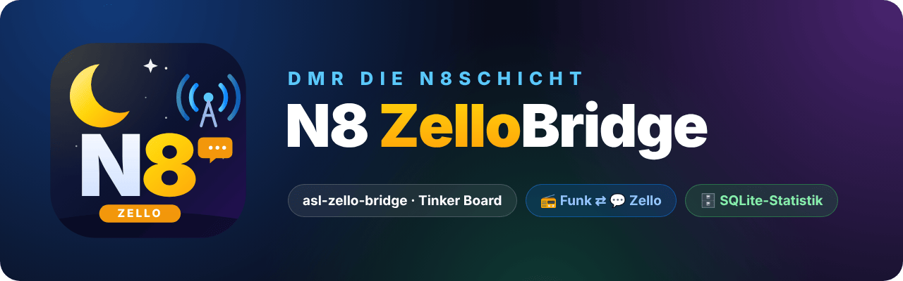
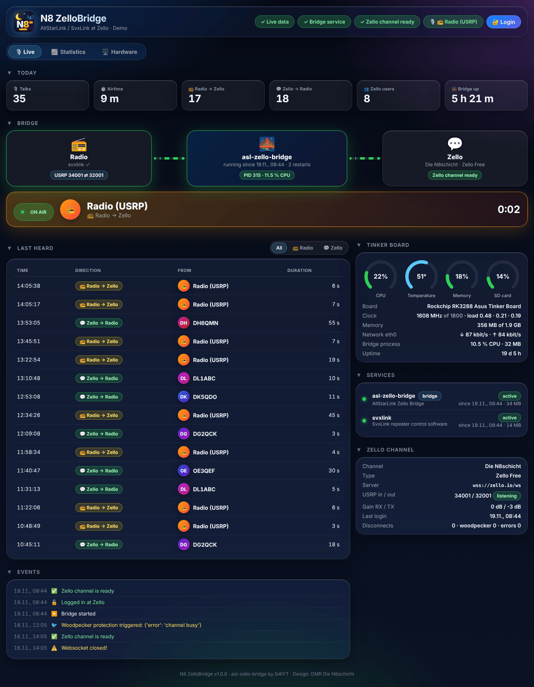
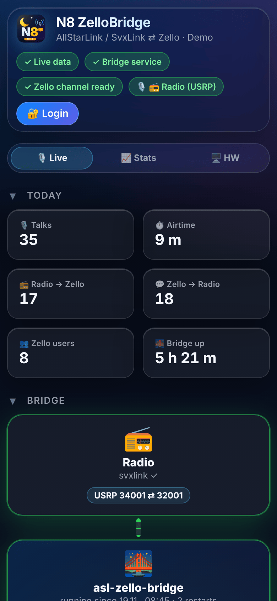
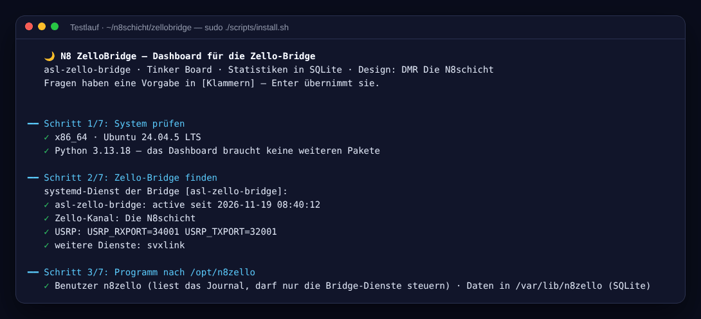
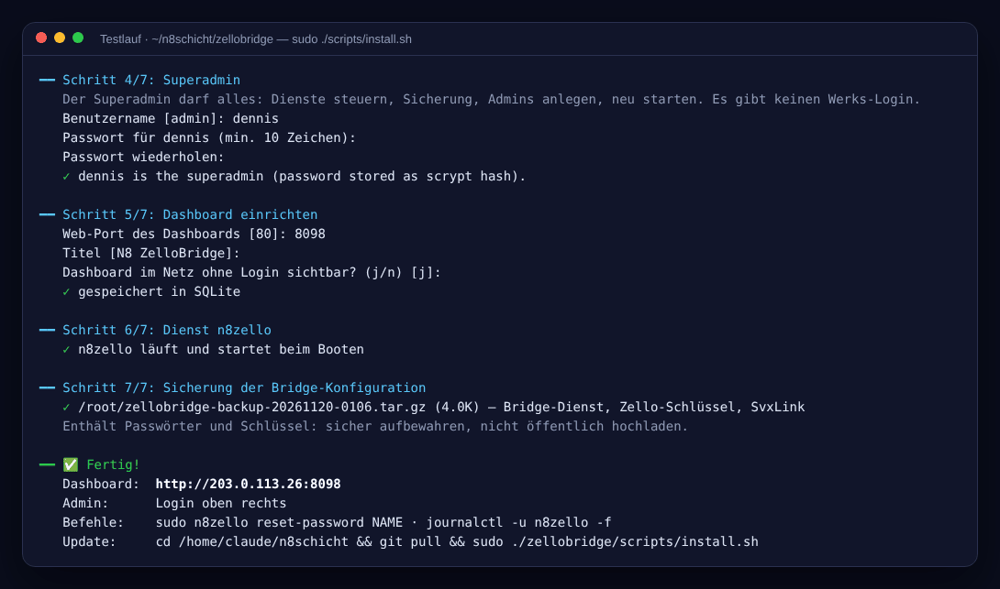
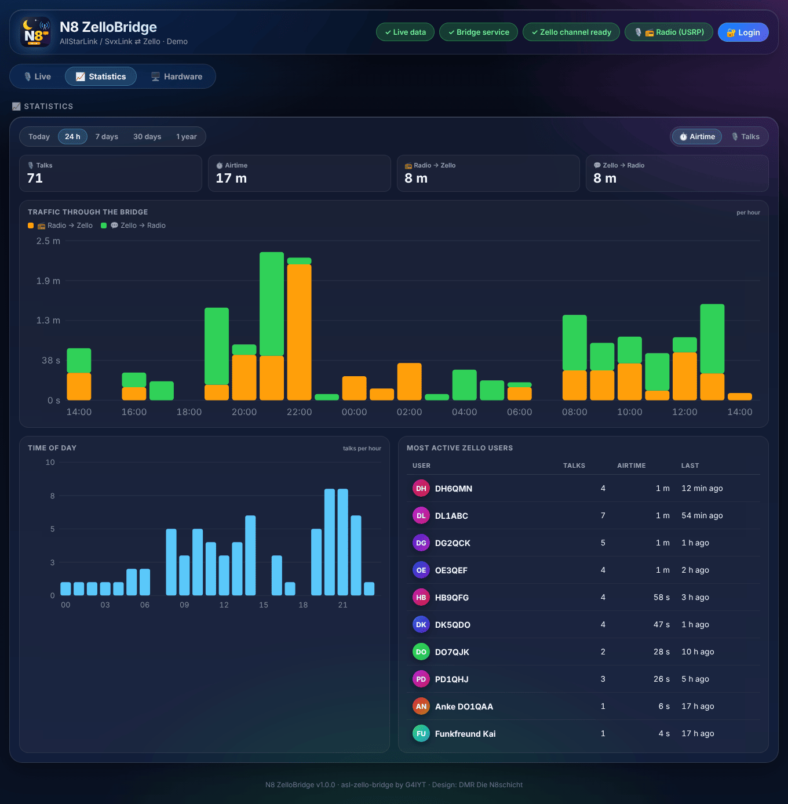
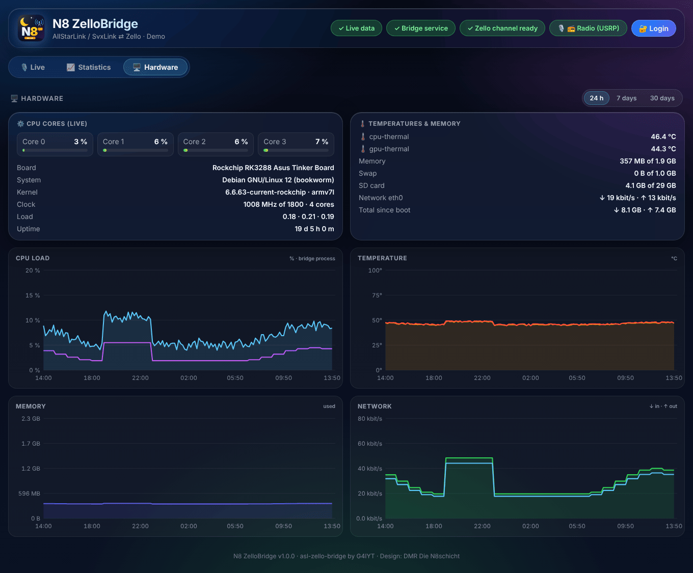
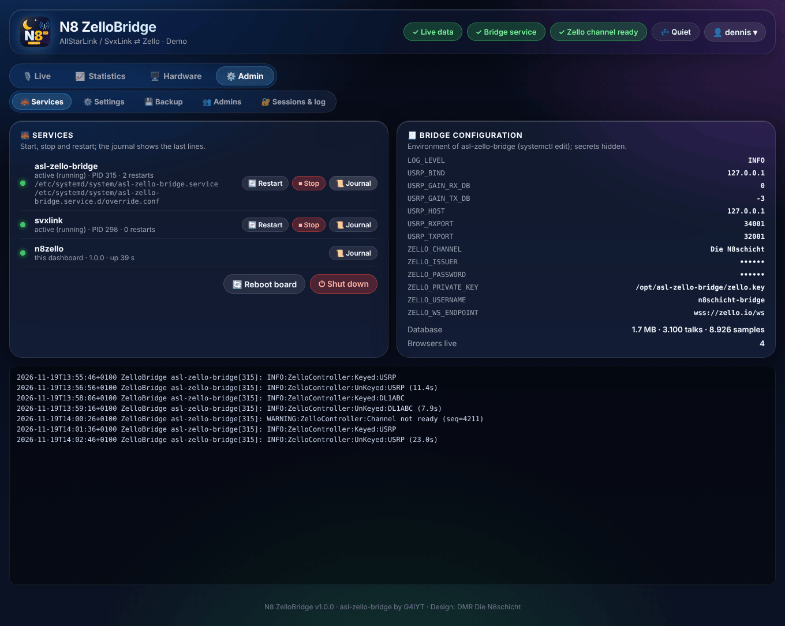
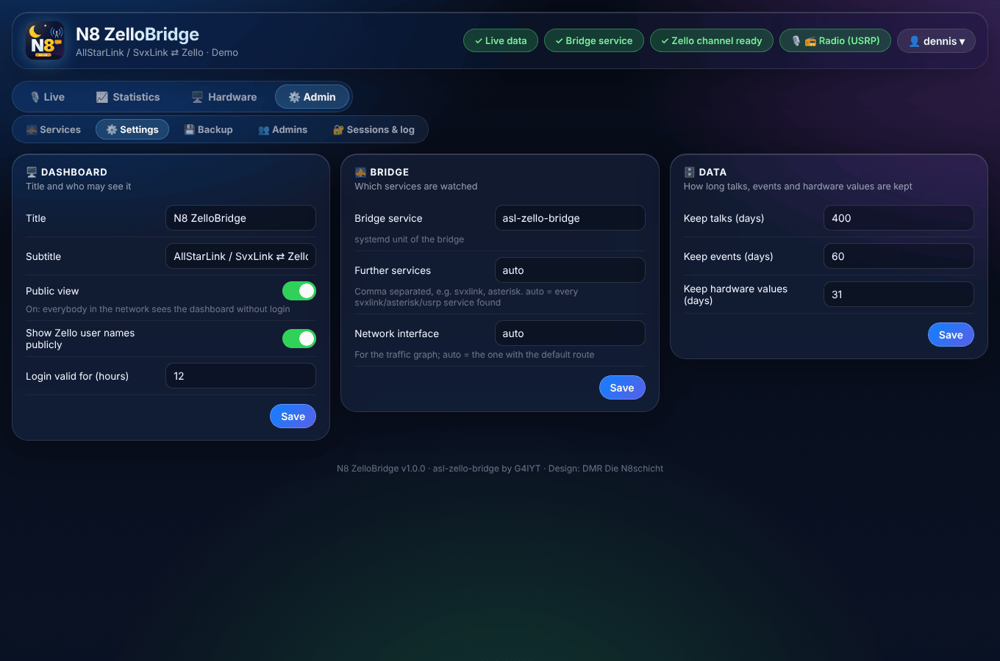
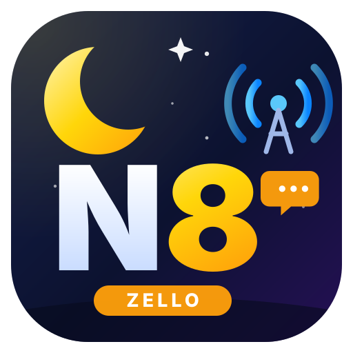

<p align="center">
  
</p>

<p align="center">
  <b>Übersichts-Dashboard für asl-zello-bridge auf dem Asus Tinker Board</b><br>
  Wer spricht gerade – Funk oder Zello –, wie läuft die Bridge, wie geht es dem Board.<br>
  Im gleichen Glas-Design wie <b>DMR Die N8schicht</b>.
</p>

<p align="center">
  <a href="#schnellstart">Schnellstart</a> ·
  <a href="docs/de/installation.md">Installation</a> ·
  <a href="docs/de/dashboard.md">Dashboard</a> ·
  <a href="docs/de/adminbereich.md">Adminbereich</a> ·
  <a href="docs/de/bridge.md">Die Bridge</a> ·
  <a href="docs/de/betrieb.md">Betrieb &amp; Sicherung</a>
</p>

---

## Was ist das?

Die **ZelloBridge** der N8schicht verbindet die Funkseite (SvxLink bzw. AllStarLink über USRP) mit einem Zello-Kanal. Sie läuft mit [asl-zello-bridge](https://github.com/mattmelling/asl-zello-bridge) von G4IYT auf einem **Asus Tinker Board** unter DietPi. Dieses Dashboard zeigt alles, was dort passiert:

| | |
|---|---|
| 🎙️ **ON AIR** | Wer gerade durch die Bridge spricht – 📻 Funk → Zello oder 💬 Zello → Funk – mit Laufzeit. Der Datenfluss Funk ⇄ Bridge ⇄ Zello ist animiert |
| 🌉 **Bridge-Werte** | Dienststatus, Laufzeit, Neustarts, Zello-Login, Kanalstatus, USRP-Ports (lauscht der Port?), Gain, Verbindungsabbrüche, Woodpecker-Schutz, Fehler |
| 🖥️ **Hardware** | CPU gesamt und pro Kern, Takt, Temperaturen, Speicher, Swap, SD-Karte, Netzwerk, Last, Uptime – und CPU/RAM des Bridge-Prozesses |
| 📈 **Statistiken in SQLite** | Durchgänge und Sprechzeit nach Richtung, Tageszeit, aktivste Zello-Nutzer, Hardware-Verläufe über 24 h bis 1 Jahr |
| ⚙️ **Adminbereich** | Bridge und SvxLink neu starten, Journal lesen, Konfiguration ansehen (Passwörter verdeckt), Sicherung herunterladen, Admins, Protokoll |
| 🪶 **Schlank** | nur Python-Standardbibliothek und SQLite – keine Pakete, unter 30 MB RAM, Live-Daten per Server-Sent Events |
| 🧭 **Geführte Installation** | `scripts/install.sh` findet die Bridge selbst, fragt den Superadmin ab (Passwort als Hash) und legt gleich eine Sicherung an |

<p align="center">
  
  &nbsp;
  
</p>

## Schnellstart

Auf dem Tinker Board (DietPi), als root:

```bash
git clone https://github.com/dhartmann1979/n8schicht
cd n8schicht/zellobridge
sudo ./scripts/install.sh
```

Das Skript führt in sieben Schritten durch alles: System prüfen, Bridge finden (Dienst, Zello-Kanal, USRP-Ports, SvxLink), Programm installieren, **Superadmin** anlegen, Port und Titel, Dienst starten, **Sicherung** der Bridge-Konfiguration. Danach im Browser `http://<IP-des-Boards>` öffnen.

<p align="center">
  
  
</p>

➡️ Ausführlich: **[Installation](docs/de/installation.md)**

## So sieht es aus

<table>
<tr>
<td width="50%"><br><b>Statistics</b>: Verkehr durch die Bridge nach Richtung, Tageszeit, aktivste Zello-Nutzer.</td>
<td width="50%"><br><b>Hardware</b>: Kerne, Temperaturen, Speicher, Netzwerk – live und als Verlauf.</td>
</tr>
<tr>
<td><br><b>Admin → Services</b>: Bridge und SvxLink steuern, Journal, Konfiguration.</td>
<td><br><b>Admin → Settings</b>: Titel, öffentliche Ansicht, überwachte Dienste, Aufbewahrung.</td>
</tr>
</table>

## Dokumentation

| Anleitung | Inhalt |
|---|---|
| 📦 [Installation](docs/de/installation.md) | Voraussetzungen, geführte Installation Schritt für Schritt, Update |
| 🎙️ [Dashboard](docs/de/dashboard.md) | Live, Statistics, Hardware – was jeder Wert bedeutet |
| ⚙️ [Adminbereich](docs/de/adminbereich.md) | Rollen, Dienste, Einstellungen, Sicherung, Admins |
| 🌉 [Die Bridge](docs/de/bridge.md) | Aufbau der ZelloBridge: SvxLink ⇄ USRP ⇄ asl-zello-bridge ⇄ Zello, Konfiguration, Neuaufbau |
| 💾 [Betrieb &amp; Sicherung](docs/de/betrieb.md) | Dienste, Sicherung und Wiederherstellung, Fehlersuche |

## Danksagung

- **asl-zello-bridge** von Matt Melling G4IYT, Idee von Rob G4ZWH – [mattmelling/asl-zello-bridge](https://github.com/mattmelling/asl-zello-bridge)
- **SvxLink** von SM0SVX und Mitwirkenden
- Design und Logo: **DMR Die N8schicht**

<p align="center"></p>
